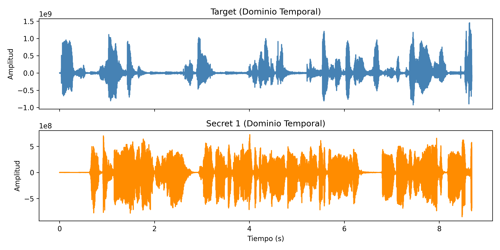
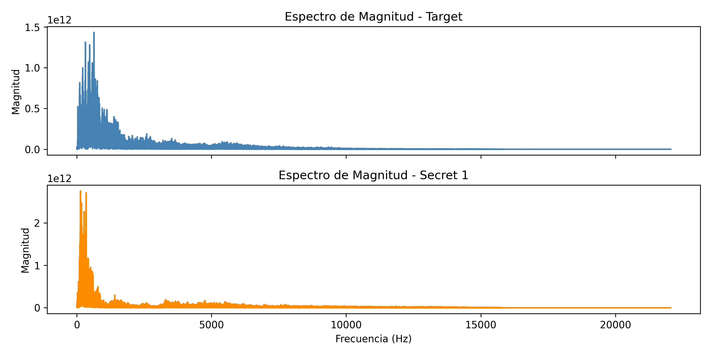
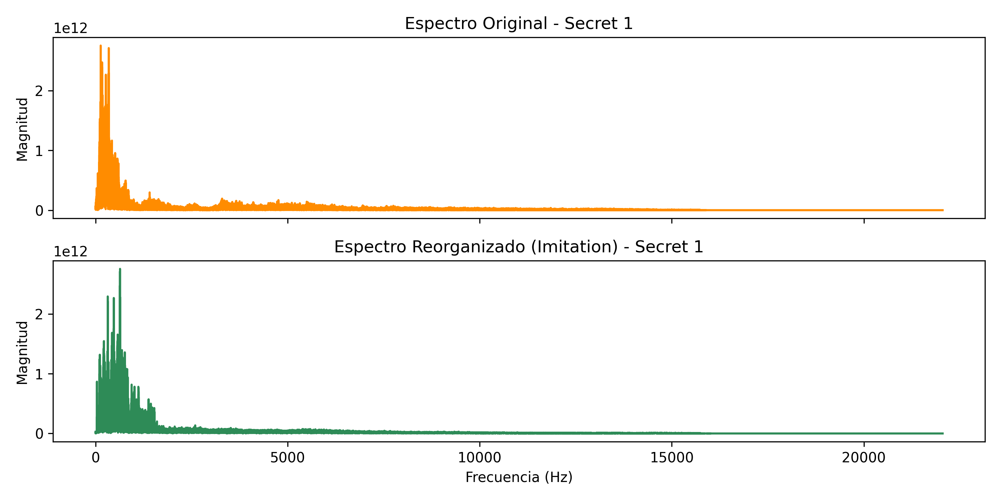
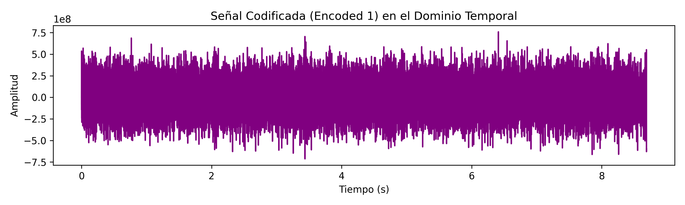

# Proyecto Final: Ocultamiento y recuperación de audio por permutación espectral
Nombre: Paula Valentina Laguna Parra

Repositorio con el desarrollo del proyecto de Análisis de Señales. Aquí se implementa el método de imitación espectral (*Imitation*) usando la Transformada Rápida de Fourier (`rfft`) para ocultar cinco mensajes de audio dentro de un espectro de referencia, junto con su recuperación (*Reverse*) y evaluación de calidad.

---

## Parte I. Análisis de Imitation

### 1. Señales en el dominio del tiempo

Cuando se grafica el **Target** y el **Secret 1** en el tiempo, se ve de inmediato que tienen niveles de amplitud distintos y que sus silencios no coinciden. Mientras en un audio las palabras y las pausas ocurren en ciertos segundos, en el otro la voz aparece en momentos totalmente diferentes, por lo que sus envolventes no se parecen.

### 2. Espectros de frecuencia (`rfft`)

Al pasar ambas señales a frecuencia, se observa que casi toda la energía está concentrada en las frecuencias bajas y medias (por debajo de los 3.000 a 5.000 Hz, que es donde suele estar la voz humana), mientras que en las frecuencias altas las magnitudes caen casi a cero. Aunque comparten ese rango general, los picos principales están en posiciones distintas y tienen diferentes alturas porque cada grabación tiene su propio timbre y tono.

### 3. Reorganización del espectro

Al comparar el espectro original del secreto con el espectro ya permutado, se puede observar que los picos principales ahora quedaron ubicados prácticamente en las mismas frecuencias que el **Target**, pero conservando los valores de amplitud del **Secret**. Esto pasa prque al ordenarlos, las magnitudes de menor a mayor y se mueve cada coeficiente complejo completo (parte real e imaginaria juntas) a la posición equivalente del Target, dejando quietos los índices DC y Nyquist. De esa forma, el audio secreto toma la forma espectral del Target sin perder su información.

### 4. Audio codificado en el tiempo

Cuando devolvemos ese espectro desordenado al dominio del tiempo usando `irfft`, la onda resultante (`encoded`) pierde todas las pausas que tenía la voz original y reparte su energía de manera pareja de principio a fin. Al reproducirlo, suena simplemente como ruido y no se alcanza a distinguir ninguna palabra.

---

## Parte III. Resultados y Evaluación de Calidad

| Mensaje secreto | SNR (dB) | Correlación de Pearson |
|---|---:|---:|
| Secret 1 | 152.4195 | 1.000000 |
| Secret 2 | 152.2085 | 1.000000 |
| Secret 3 | 152.4095 | 1.000000 |
| Secret 4 | 152.3738 | 1.000000 |
| Secret 5 | 152.2705 | 1.000000 |

### Análisis de los resultados

* **Cuál se recuperó mejor:** El **Secret 1** tuvo el mejor resultado con un SNR de **152.4195 dB**, seguido muy de cerca por el **Secret 3** con **152.4095 dB**.
* **Comparación entre los cinco audios:** Los valores son bastante parejos en todos los casos. Entre el SNR más alto y el más bajo solo hay una diferencia de **0.211 dB**, lo que demuestra que el algoritmo funciona igual de bien sin importar qué diga cada audio secreto.
* **Qué nos dicen las dos métricas:** Una correlación de Pearson de **1.000000** confirma que la forma de onda recuperada quedó alineada y con la misma forma que la original. Por su parte, tener un SNR por encima de **152 dB** nosmuestra que la señal útil es muchísimo mayor que el ruido o error residual, así que al escuchar los cinco archivos recuperados suenan idénticos a los originales.
* **Por qué existe un pequeño error:** Aunque al cambiar el orden de los índices es un proceso matemático exacto y reversible, Python realiza los cálculos internos de `rfft` e `irfft` en formato de 64 bits (`float64`), mientras que al guardar los audios en `.wav` se pasan a 32 bits (`float32`). Ese pequeño redondeo al guardar y volver a cargar los archivos es lo que genera una diferencia mínima y hace que el SNR sea de unos 152 dB en lugar de infinito.

